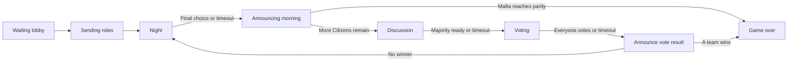

# DBot

My first Discord bot, built with Python for learning and fun.

**Current version: complete Mafia rounds.** Friends receive secret roles, choose
night targets, discuss, and vote. Rounds repeat automatically until Mafia or
Citizens win. Doctor and Police are future roles.

Start with a few commands, understand how they work, then add one feature at a time.
This version follows the prefix-command approach in the
[freeCodeCamp tutorial](https://www.freecodecamp.org/news/how-to-build-a-basic-discord-bot-with-python/).
It runs locally without an AI service or database.

## 1. Set up Python

Use Python 3.12 or newer. Open PowerShell in this project's folder:

```powershell
python --version
python -m venv .venv
.\.venv\Scripts\python.exe -m pip install -r requirements.txt
Copy-Item .env.example .env
```

The virtual environment (`.venv`) gives this project its own installed packages.
These commands use its Python directly, so you do not need to activate it or
change PowerShell's execution policy.

## 2. Create and invite your bot

1. Open the [Discord Developer Portal](https://discord.com/developers/applications).
2. Create an application named DBot and open its **Bot** settings.
3. Generate a bot token (use **Reset Token** if necessary).
4. Open your local `.env` file and replace the placeholder with that token.
   Keep the token private; do not paste it into chat or commit it to GitHub.
5. In **Bot > Privileged Gateway Intents**, enable **Message Content Intent**
   and save. The code also enables this intent; both settings are required.
6. Open **OAuth2 > URL Generator**, select the **bot** scope, and select
   **View Channels**, **Send Messages**, **Read Message History**, and
   **Embed Links** permissions.
7. Open the generated URL and invite the bot to a test server you manage.
   Make sure the test channel permits these permissions for your bot.

The token belongs in `.env` like this:

```dotenv
DISCORD_TOKEN=paste_your_bot_token_here
```

`.gitignore` excludes `.env`. `.env.example` contains only a placeholder and is
safe to commit. If a real token is ever shared or committed, reset it in the portal;
deleting the text alone does not revoke it.

## 3. Run and try it

```powershell
.\.venv\Scripts\python.exe bot.py
```

Leave the terminal running, then send these messages in your test server:

| Command | What happens |
| --- | --- |
| `!hello` | DBot greets you by display name. |
| `!roll` | Rolls a six-sided die. |
| `!roll 20` | Rolls a twenty-sided die. |
| `!roll banana` | Explains that the input must be a whole number. |
| `!roll 1` | Explains the allowed range of 2 to 100 sides. |
| `!help` | Shows the commands and their descriptions. |
| `!help roll` | Shows help for the dice command. |

Press **Ctrl+C** in the terminal to stop the bot. It is online only while this
program is running and connected to Discord.

## 4. Understand your first command

```python
@bot.command()
async def hello(ctx):
    """Say hello to the person using the command."""
    await ctx.send(f"Hello, {ctx.author.display_name}! I'm DBot.")
```

- `@bot.command()` registers the function as a command called `hello`.
- `async def` defines a function that can pause while waiting for network work.
- `ctx` is the command's context: who sent it, in which channel, and more.
- `await ctx.send(...)` waits for Discord to receive the reply while allowing
  the bot to handle other work.
- The `f"..."` string inserts the user's display name into the message.
- The triple-quoted description becomes part of the built-in `!help` output.

In `roll`, `sides: int = 6` asks the command framework to convert input into an
integer and use 6 when no input is provided. The range check rejects unsuitable
values, and `random.randint(1, sides)` picks a result including both endpoints.

`on_ready` is an event handler: Discord triggers it when the bot is ready.
Unlike a command, it does not need someone to type `!ready`.

## 5. Your first exercise

Add a coin-flip command above the `if __name__ == "__main__":` block.
Use the same pattern as `hello`, name the function `coin`, and send the result of
`random.choice(["Heads", "Tails"])`. Restart the bot and try `!coin` and `!help`.

After that, try these small milestones:

1. Add rock-paper-scissors to practice conditions and validating input.
2. Add a branching story using a dictionary to remember each player's location.
   That dictionary resets whenever the program restarts.
3. Save story progress in SQLite to learn persistent storage.
4. Explore slash commands and buttons, then consider hosting when local play works.

## Mafia: try it with friends

Start the bot using the command above, then use a normal server text channel.
The starter supports **3-6 human players**, with exactly **1 Mafia** and the
remaining players as **Citizens**. With three players, the first night kill gives
the Mafia a win (one Mafia and one Citizen remain). Try five or six players to
reach the discussion phase.

| Who | Command | What happens |
| --- | --- | --- |
| Host | `!mafia create` | Creates this channel's lobby and joins automatically. |
| Friends | `!mafia join` | Joins the open lobby. |
| Anyone | `!mafia lobby` | Lists players, host, and current phase without roles. |
| Player | `!mafia leave` | Leaves before roles are assigned. |
| Host | `!mafia start` | Sends secret roles by DM and begins Night 1. |
| Mafia, in DMs | `!mafia kill <player-number>` | Locks a final target and triggers morning. |
| Living players, in server | `!mafia ready` | Marks ready to vote; a majority skips the remaining discussion time. |
| Living players, in server | `!mafia vote <player-number>` | Casts a final vote to eliminate another living player. |
| Living players, in server | `!mafia vote skip` | Casts a final vote for no elimination. |
| Host | `!mafia cancel` | Clears the lobby and invalidates its role assignments. |
| Host | `!mafia transfer <player-number>` | Hands hosting to another participant. |
| Player | `!mafia forfeit` | Permanently leaves an active match; this may decide the winner. |
| Server manager | `!mafia forcecancel` | Stops a game; requires Manage Server permission. |
| Anyone | `!mafia` | Shows the commands. |

Before starting, each player should allow DMs from the bot (Discord's server
privacy setting for direct messages from server members may need enabling).
If any role cannot be delivered, the bot cancels the assignment and clears the
lobby. Discard any DMs from that attempt, fix DM access, and create a fresh lobby.
Every role DM includes the server and channel. Roles take effect when
Night 1 is announced in that channel. Roles never appear in the public player list.

### Night 1 and target selection

1. The host starts the game. After all role DMs are delivered, the bot announces
   **Night 1** in the server channel. Everyone should stay quiet during the night.
2. The Mafia opens the bot's DM. Under **Choose a target**, each eligible player
   has a name, number, and a complete command to copy. For example:

   ```text
   3. Alice — !mafia kill 3
   ```

   To target Alice, copy just the command and send it back in the bot's DM:

   ```text
   !mafia kill 3
   ```

   The player number is already filled in. Your own name is excluded from the
   target list. The bot finds your game from your Discord account, so you do not
   need to include a game ID.
3. **The choice is final.** The bot confirms it privately and automatically ends
   the night. A second choice is rejected. Citizens have no night action yet.
4. Night lasts **at most two minutes**. If the Mafia makes no choice before the
   deadline, morning arrives with **no elimination**. Otherwise, the selected
   player is eliminated. The bot announces the result and updates the living
   player list; the victim's role remains secret. No host command is needed.
5. If the Mafia equals or outnumbers the remaining Citizens, the bot announces a
   Mafia win and marks the game finished. Otherwise, it enters **discussion**.
   Discussion leads to voting and then the next night unless a team has won.

### Discussion, voting, and later rounds

| Phase | Maximum duration | Ends early when |
| --- | --- | --- |
| Night | 2 minutes | The Mafia submits a final target. |
| Discussion | 2 minutes | More than half of living players use `!mafia ready`. |
| Voting | 1 minute | Every living player submits a vote, including skips. |

Phase announcements use Discord embed cards: purple for night, gold for morning,
blue for voting, and red or green for the winning team. Results, player counts,
and the next action appear in separate sections. Durations use readable units
such as **2 minutes**. A winning result gets a game-over title instead of
discussion instructions. Each phase still sends one announcement.

For the card layout, allow **Embed Links** in the game channel. If that permission
is disabled, the bot sends the same information as spaced text instead.

During discussion, talk in text or voice. If you already know how you want to
vote, type **`!mafia ready`** in the game channel. With five living players,
three ready players start voting immediately. Each person counts once; the host
has the same ready vote as everyone else. An individual cannot skip discussion
for the whole group.

When the bot announces voting, send **`!mafia vote 3`** to vote for player 3, or
**`!mafia vote skip`** to vote for no elimination. Your vote is final. You cannot
vote for yourself or an eliminated player. The numbered roster appears in the
voting announcement, and numbers stay the same throughout the game.

A player needs **more than half of all living players' votes** to be eliminated.
For example, five living players require three votes, even if only two people
submit votes before time expires. Ties, skips, and missing votes can therefore
produce no elimination. After the result:

- **Citizens win** if all Mafia players are eliminated.
- **Mafia wins** if the Mafia equals or outnumbers the remaining Citizens.
- **Draw** after three consecutive complete rounds with no eliminations.
- Otherwise, **Night 2, Night 3, and later rounds** begin automatically.

Roles are assigned only once. Before every later night, the Mafia gets a fresh
DM listing living targets. Ready votes and daytime votes reset for the next
round. Eliminated players may watch but cannot choose targets, mark ready, or vote.
The host can still cancel even if eliminated. Completed games stop their worker;
use `!mafia cancel` to clear the channel immediately, or wait for automatic cleanup.

Target selection is accepted only in DMs, during the night, from that game's
living Mafia player. Self-targets, eliminated players, invalid numbers, repeat
choices, and choices after the deadline are rejected. The public morning message
announces the result without revealing who submitted the choice. If you
accidentally type the command in a server channel, the bot rejects it, but your
own message is still visible there: always send night choices in the bot's DM.

Each timer starts after its phase announcement is delivered. One background task
runs the entire game and stops when a team wins, the host cancels, or the bot shuts
down. To adjust durations, change `NIGHT_SECONDS`, `DISCUSSION_SECONDS`, or
`VOTING_SECONDS` in `mafia.py` and restart. Values are in seconds.
There are no automatic channel mutes. Players can use text or voice for discussion.
Use `!mafia lobby` to see the current phase and which players are eliminated;
player numbers stay the same after a death.

Once roles have been sent, joining and starting again are blocked. Use
`!mafia forfeit` to leave permanently. During message delivery, wait for the next
phase before forfeiting or transferring hosting. The host can cancel at any time,
including while role DMs are being sent.

Each channel has an independent lobby, but each player may join **one active
game at a time**, including waiting lobbies. This keeps private commands
unambiguous. Leave an open lobby, forfeit, have its host cancel, or wait until the
game finishes before joining another. Eliminated players still belong to their
game unless they forfeit. A finished game releases its players immediately.
All lobbies are stored in memory: restarting the bot clears them and invalidates
old role DMs. Games do not resume after a restart.

### Leaving, abandoned games, and cleanup

The host can use `!mafia transfer 2` with a number from `!mafia lobby`. If the
host leaves a waiting lobby or forfeits an active game, hosting passes to the
first remaining eligible player. The final player leaving closes the lobby.
Other players cannot start or cancel it; server managers can use
`!mafia forcecancel` when intervention is needed.

Forfeiting removes the player from play without revealing their role. Votes cast
by or against them are cleared; affected voters may vote again. A departed night
target is cleared. Player numbers stay fixed during active games. A forfeit can
immediately produce a team win. If everyone leaves, the game closes without
declaring a winner.

| Cleanup rule | Default |
| --- | --- |
| Waiting lobby not started | Expires 10 minutes after creation. |
| Active game without a valid player action | Closes after 15 minutes of inactivity. |
| Finished game | Clears from its channel after 5 minutes. |
| Consecutive complete rounds without eliminations | Draw after 3 rounds. |
| Maintenance and server membership checks | Runs every 30 seconds, plus request time. |

These settings live in `LifecyclePolicy` in `mafia_lifecycle.py`. Expiry cleanup
may wait for the next maintenance pass. The bot confirms server departures with
Discord membership requests; going offline does not remove a player. This does
not require the privileged Server Members Intent. Failed membership requests
keep unverified players rather than treating them as departed.

One game worker applies departures between phase announcements. Startup and
worker tasks are tracked and cancelled on shutdown or game cancellation, so an
old task cannot start a later phase in a replacement game. Critical network
requests time out after 5 seconds. Temporary phase delivery failures allow up
to 5 attempts, 5 seconds apart, then close the game. A blocked later-night DM
also stops the game with a generic public message that keeps roles private.

### Understand the new code

The code separates rules, Discord commands, card layouts, and connection setup.
Start with the rules, then read the commands that call them.

| File | Responsibility | Start reading at |
| --- | --- | --- |
| `mafia_game.py` | Players, roles, legal actions, votes, and winners. Uses only standard Python. | `GameState`, then `lock_target()` and `cast_vote()` |
| `mafia.py` | Discord commands, message formatting, and the game worker. | `Lobby`, `Mafia.kill()`, then `run_game()` |
| `mafia_cards.py` | Titles, colors, fields, readable durations, and text fallback. | `night_card()`, `morning_card()`, then `send_card()` |
| `mafia_lifecycle.py` | Cleanup policy and confirmed server departure checks. | `LifecyclePolicy`, then `check_once()` |
| `scripts/simulate_games.py` | Complete offline games with deterministic random players. | `simulate_match()` |
| `bot.py` | Loads the token, configures the Discord connection, and registers commands. | `DBot.setup_hook()` and `bot.run(token)` |
| `tests/` | Checks both the rules and the Discord integration with fake messages. | `test_mafia_game.py`, then `test_mafia.py` |

The `Mafia` class is a **cog**, discord.py's way of grouping related commands.
`DBot.setup_hook()` registers that cog once during startup. `on_ready()` prints
when the connection is ready; it does not assign roles or create timer tasks.

#### The technologies

- **Python** expresses the rules and stores game state.
- **discord.py** receives Discord events, parses commands, and sends messages.
  Discord calls a server a **guild**, which explains `guild_only()` in the code.
- **asyncio**, built into Python, runs commands and timers together without
  blocking while waiting for network requests or night choices.
- **python-dotenv** reads your local `.env` token into the environment.
  This happens in `main()` when you run the script, rather than when tests import it.
- **unittest** and **AsyncMock**, also built into Python, test the code without
  connecting to Discord. Git/GitHub track versions; they do not run the bot.

There is no database or AI service. State lives in the running Python process,
so a restart clears every game. A role is game data, not a Discord server role;
the bot does not need Manage Roles permission.

#### How state represents the game

`GameState` is a **dataclass**: Python generates its constructor and other useful
methods from its declared fields. Each lobby gets a separate instance.

- `game.players` is an ordered **list** of Discord user IDs. Player number 3 means
  `game.players[2]`, because Python indexes lists starting at zero.
- `game.roles` is a **dictionary** mapping each player ID to Mafia or Citizen.
- `game.alive` is a **set** of living player IDs, so membership checks such as
  `player_id in game.alive` are straightforward.
- `game.phase` records which actions are allowed now.
- `game.night_target` is an ID when someone is chosen, or `None` for no choice.
- `game.night_deadline` uses the event loop's monotonic clock: changing the wall
  clock or time zone does not change the night duration.
- `game.night_number` counts rounds. `game.ready_players` is a set of IDs, so
  duplicate ready commands cannot count twice. `game.votes` maps each voter ID
  to a target ID or `None` for skip.
- Discussion and voting have their own deadlines. A late command is rejected
  even if the worker has not yet posted the next phase's announcement.

`Role` and `Phase` are **enums**: named values such as `Role.MAFIA` and
`Phase.NIGHT` reduce spelling mistakes in comparisons. Type hints help your
editor understand the intended values; the explicit checks enforce the rules.

Elimination removes an ID from `alive`, while leaving `players` in the same order.
That is why player numbers do not shift when someone dies.

`Lobby` holds a `GameState` together with Discord-specific resources:
`members` maps IDs to Discord member objects, `channel` is where to announce
results, and `game_task` runs all phases. Three events (`night_ready`,
`discussion_ready`, and `votes_ready`) signal when a phase can end early. `self.lobbies`
maps each channel ID to its lobby. The one-active-game rule makes it possible
to find a sender's game even when their command arrives through a DM.

#### The state machine



The temporary `assigning` and `resolving` phases are important. While Discord
is delivering messages, other commands may run. Those phases prevent a second
start, roster changes, or another resolution from interfering. A failed morning
post restores `night` so the worker can retry; its choice remains locked.
Voting announcements and vote results also use temporary phases, with rollback
on failed delivery. Elimination results are committed after successful delivery.

#### Follow one command: `!mafia kill 3`

1. discord.py recognizes the `!` prefix, finds `mafia kill`, and converts `3`
   into an integer because the callback declares `player_number: int`.
2. `@commands.dm_only()` rejects the command if it came from a public channel.
3. `Mafia.kill()` finds the sender's active lobby from their Discord account ID.
4. `GameState.lock_target()` checks the role, living status, phase, deadline,
   previous choice, and target number. It rejects self-targets and dead targets.
5. The game saves the actual target ID. `lobby.night_ready.set()` wakes the timer.
   The bot sends a private confirmation. If that confirmation fails, the saved
   action still succeeds; it does not ask the player to repeat a final choice.
6. The timer calls `resolve_night()`. `prepare_morning()` calculates an immutable
   `EliminationOutcome` and changes the phase to `resolving`, without removing anyone yet.
7. The bot posts the morning result. After delivery succeeds, `complete_morning()`
   updates `alive`, clears the target, and enters discussion or game over.

The same worker then waits for the discussion-ready event or deadline. `ready()`
calls `mark_ready()` and sets the event when `len(ready_players)` reaches
`len(alive) // 2 + 1`. It opens voting, waits for all votes or the voting deadline,
and calculates the result with `Counter`. Skips are excluded from candidate
counts, but the majority threshold still uses all living players. If no team
wins, the worker announces the next night and clears events for the new round.

The target checks and save contain **no `await`**. In this single event loop,
another command cannot slip in between checking the deadline and locking a choice.

#### What `async` and `await` actually do

`async def` defines a coroutine. Calling it creates work that must be awaited or
scheduled. `await` can hand control back to the event loop while that work waits;
it does not automatically create another thread. An await that completes
immediately does not have to suspend execution.

```python
await asyncio.wait_for(lobby.night_ready.wait(), timeout=remaining)
```

This means "wait for the final-choice signal, but only until the deadline."
While it waits, the bot can handle commands in other channels. If time runs out,
`TimeoutError` leads to a morning with no victim. `asyncio.create_task()` schedules
this coroutine so `!mafia start` can return immediately. Using `time.sleep(120)`
instead would block the event loop and stop it handling commands during the wait.

Cancelling a lobby cancels its worker. Shutdown clears all lobbies and cancels
all pending workers; a shutdown during role delivery cannot start a new timer.
An old task checks that its lobby is still the current object for that channel
before resolving or deleting anything, protecting replacement games.

#### Expected mistakes versus delivery failures

`GameRuleError` means a player tried an illegal action. The Discord adapter
turns it into a readable reply. These rule exceptions do not need Discord imports.

Temporary HTTP failures retry phase messages every five seconds, up to five
attempts, preserving the same result. If the channel was deleted or permissions were removed, the bot
stops the game, frees its participants, and attempts to notify the host by DM.
Other permanent Discord request errors also stop the game instead of retrying
forever. If only Embed Links permission changed, card delivery retries as text.
An unexpected worker error is logged and also stops the game, rather than leaving
everyone stuck in a night with no running timer.

In `test_mafia_game.py`, rules use fixed values such as `now=100`, so a deadline
can be tested without waiting two minutes. In `test_mafia.py`, `AsyncMock` stands
in for Discord's send methods and records what would have been sent. These checks
verify our logic; testing with friends still verifies the actual Discord setup.

The role names are game data, not Discord server roles; the bot does not need
Manage Roles permission. Keep the token in your own `.env`, as before.

### Check your changes

You can run complete games alone without starting the bot:

```powershell
.\.venv\Scripts\python.exe -m scripts.simulate_games --games 500 --seed 7
```

This runs 3–6 simulated players with a clock that advances instantly. Every tenth
game deliberately makes no elimination to exercise the draw limit. It checks
that every game ends, roles and numbers stay fixed, and eliminated players do
not return. The same seed reproduces the run. Random-player results do not
measure balance with human players.

Automated checks need no token, extra test packages, or Discord connection:

```powershell
.\.venv\Scripts\python.exe -m unittest discover -s tests -v
```

For the live check, create a lobby with friends, join, and start. Have the Mafia
DM `!mafia kill 3` (using a valid target number). Morning should arrive without a
host command. In a fresh game, make no choice and check that morning arrives
after two minutes with no death. Also try a Citizen's choice, an invalid target,
a second choice, and joining two lobbies. Those should be rejected. Check that
cancelling a night stops its timer and does not produce a later morning message.

During discussion, have a majority use `!mafia ready` and confirm voting starts
early. Submit votes or skips from every living player to end voting early. Try a
split vote, then a majority vote against the Mafia. Check that a no-winner result
leads to Night 2 with the same roles, updated living targets, and unchanged numbers.

### Development quality checks

Install the optional development tools into the same virtual environment:

```powershell
.\.venv\Scripts\python.exe -m pip install -r requirements-dev.txt
.\.venv\Scripts\python.exe -m pip check
.\.venv\Scripts\python.exe -m ruff check .
.\.venv\Scripts\python.exe -m ruff format --check .
.\.venv\Scripts\python.exe -m coverage run -m unittest discover -s tests -v
.\.venv\Scripts\python.exe -m coverage report --fail-under=90
```

Ruff catches common errors and keeps formatting consistent. Coverage measures
which statements and branches the tests exercise; the check requires at least
90% combined coverage. To format an intentional code change, run
`.\.venv\Scripts\python.exe -m ruff format .` before checking again.

The voting tests enumerate all **2,692** valid ballot combinations for three-
and four-player games, including skipped and missing votes. Integration tests
exercise multiple rounds, both winners, timing boundaries, cancellation, failed
messages, and private-command checks. Startup tests replace token loading and
login with mocks, so they never need or use your actual Discord token.

`.github/workflows/tests.yml` runs linting, formatting, dependency checks, and
tests on pushes and pull requests, using Python 3.12 and 3.14 on Windows and Linux.
`pyproject.toml` stores the shared check settings. `.gitattributes` keeps text line
endings consistent across both operating systems. Local caches and coverage files
are ignored by Git.

## Troubleshooting and references

- **Bot is online but silent:** check the `!` prefix, Message Content Intent in
  both places, and the channel's permissions.
- **Announcements appear as text instead of cards:** enable Embed Links for the
  bot in that channel. The text fallback keeps the game playable without it.
- **Morning cannot be posted:** temporary delivery errors allow five attempts,
  five seconds apart, then close the game.
  If the channel was deleted or Send Messages permission was removed, the game is
  cancelled and the bot tries to DM the host. Fix the channel access and create
  a new lobby. Unexpected worker failures are reported in the bot's terminal.
- **Missing token:** check that the file is named `.env`, not `.env.txt`, and that
  you replaced the placeholder. An existing `DISCORD_TOKEN` environment variable
  takes precedence over `.env`.
- **Login failure:** use the bot token from the Bot settings, rather than the
  application ID or client secret. Reset the token if it is invalid.
- **Missing Python or module:** confirm Python is installed and run the commands
  using `.\.venv\Scripts\python.exe` after creating the virtual environment.
- Avoid naming your script `discord.py`, which would shadow the installed library.

Official references: [Quickstart](https://discordpy.readthedocs.io/en/stable/quickstart.html),
[commands](https://discordpy.readthedocs.io/en/stable/ext/commands/commands.html),
[intents](https://discordpy.readthedocs.io/en/stable/intents.html), and
[bot accounts](https://discordpy.readthedocs.io/en/stable/discord.html).
